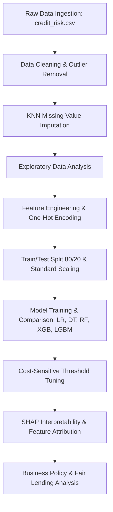

# Loan Default Prediction & Credit Risk Analysis: An Applied Machine Learning Study


An end-to-end Machine Learning and Explainable AI (XAI) project to predict consumer loan default risk, evaluate asymmetric financial business costs, and identify key drivers of credit default using Tree-based Ensembles and SHAP.

---

## Kaggle Dataset Origin & Citation

The primary dataset utilized in this project is sourced directly from Kaggle:
- **Dataset Reference**: [**Credit Risk Analysis Dataset on Kaggle **](`credit_risk.csv`)
- **Dataset Scope**: 32,581 loan applicant records with 11 predictor features and 1 binary target variable (`Status`).
- **Post-Cleaning Scope**: 31,522 high-integrity records following outlier removal and deduplication.
- **Target Distribution**: ~22% default rate (realistic moderate class imbalance).

---

## Executive Summary

Credit risk modeling is fundamental to retail banking and fintech lending operations. In traditional credit underwriting, inaccurate classifications carry severe asymmetric financial consequences: **missing an actual loan default (False Negative) costs financial institutions significantly more in unrecovered principal than turning away a creditworthy applicant (False Positive) in lost interest revenue**.

This project establishes a complete data science pipeline using the benchmark Kaggle loan dataset:
- **Robust Preprocessing & Imputation**: Outlier mitigation and KNN-based imputation to handle realistic credit bureau data imperfections.
- **Multi-Model Benchmarking**: Systematically comparing 5 classification architectures ranging from linear baselines to state-of-the-art gradient boosted trees.
- **Cost-Sensitive Decisioning**: Custom loss-matrix threshold optimization demonstrating a **46.9% reduction in missed loan defaults** (399 down to 212) under a 5:1 business cost penalty.
- **Model Explainability (XAI)**: SHAP (SHapley Additive exPlanations) values to extract global feature impacts and local decision drivers for regulatory transparency.

---

## Research Questions & Objectives

1. **Predictive Capability**: Can consumer loan default risk be reliably predicted from demographic, financial capacity, and loan structure features?
2. **Key Risk Drivers**: Which specific attributes exert the strongest causal and statistical influence on default probability?
3. **Threshold Calibration**: How does adjusting the classification threshold to reflect asymmetric default costs (5:1 loss ratio) optimize institutional bottom-line performance?
4. **Interpretability & Fairness**: How do tree split heuristics (Gain/Weight) compare with game-theoretic SHAP values, and what are the regulatory implications under fair lending laws (ECOA)?

---

## Dataset & Feature Dictionary

| Feature Name | Cleaned Column Name | Type | Description |
| :--- | :--- | :--- | :--- |
| `ID` | *Dropped* | Numerical | Unique applicant identifier (excluded from modeling) |
| `Age` | `Age` | Numerical | Age of the loan applicant in years |
| `Income` | `Income` | Numerical | Annual income of applicant ($ USD) |
| `Home` | `Home_Ownership_Status` | Categorical | Home ownership category (`RENT`, `OWN`, `MORTGAGE`, `OTHER`) |
| `Emp_Length` | `Employment_In_Years` | Numerical | Employment tenure in years (imputed via KNN) |
| `Intent` | `Loan_Purpose` | Categorical | Purpose of loan (`PERSONAL`, `EDUCATION`, `MEDICAL`, `VENTURE`, `HOMEIMPROVEMENT`, `DEBTCONSOLIDATION`) |
| `Amount` | `Loan_Amount_Applied` | Numerical | Requested loan principal amount ($ USD) |
| `Rate` | `Interest_Rate` | Numerical | Loan interest rate percentage (imputed via KNN) |
| `Percent_Income`| `Percent_income` | Numerical | Loan-to-income ratio (`Amount / Income`) |
| `Default` | `Default_History` | Categorical | Historical credit default indicator (`Y` = Yes, `N` = No) |
| `Cred_Length` | `Credit_History_Length`| Numerical | Length of credit history in years |
| **`Status`** | `Status` | Binary | **Target Variable**: Loan default status (`0` = Non-Default, `1` = Default) |

---

## Tools & Libraries

- **Language**: Python 3.10+
- **Data Manipulation**: `pandas`, `numpy`
- **Visualization**: `matplotlib`, `seaborn`
- **Preprocessing & Modeling**: `scikit-learn` (`StandardScaler`, `KNNImputer`, `train_test_split`, `metrics`)
- **Gradient Boosted Trees**: `xgboost` (XGBClassifier), `lightgbm` (LGBMClassifier)
- **Model Interpretability**: `shap` (`TreeExplainer`, summary plots, force plots)
- **Hypothesis Testing**: `scipy.stats`
- **Environment**: Jupyter Notebook, Docker

---

## End-to-End Methodology



### 1. Data Cleaning & Integrity Auditing
- **Outlier Mitigation**: Filtered unfeasible records (e.g., Applicant `Age > 100` and `Employment_In_Years > 60`).
- **Deduplication**: Audited and pruned 165 duplicate applicant records.
- **Type Optimization**: Converted textual categories to optimized categorical representations.

### 2. Missing Value Imputation (KNN)
- Avoided crude mean/median replacements which distort variance.
- Applied **K-Nearest Neighbors (`KNNImputer`, k=5)** over normalized numerical spaces to reconstruct missing values for `Employment_In_Years` and `Interest_Rate`.

### 3. Exploratory Data Analysis (EDA)
- **Loan-to-Income Divergence**: Applicants who defaulted exhibited significantly elevated loan-to-income (`Percent_income`) ratios.
- **Housing Status Signal**: Renters demonstrated ~4x higher default frequency relative to mortgaged/home-owning peers.
- **Purpose Risk Profile**: Debt consolidation and medical loan categories exhibited heightened baseline delinquency rates.

### 4. Feature Engineering & Scaling
- One-hot encoded multi-class variables (`Home_Ownership_Status`, `Loan_Purpose`) using `drop_first=True` to prevent the dummy variable trap.
- Standardized numeric matrices using `StandardScaler` for distance-based estimators.

### 5. Multi-Model Architecture Benchmarking
- Stratified 80/20 train/test partitioning.
- Evaluated models across **ROC-AUC, Precision, Recall, and F1-Score**.

### 6. Asymmetric Cost-Sensitive Threshold Tuning
- In lending, the financial loss of a False Negative (unrecovered principal) is substantially higher than a False Positive (cost of manual review).
- Calibrated an optimal decision threshold under an illustrative 5:1 cost penalty ratio.

### 7. Model Explainability via SHAP
- Leveraged Game-Theoretic Shapley values (`shap.TreeExplainer`) to dissect exact marginal feature contributions across individual and global loan profiles.

---

## Model Performance & Comparison

| Model Architecture | ROC-AUC | Recall | Precision | F1-Score | Status |
| :--- | :---: | :---: | :---: | :---: | :---: |
| **XGBoost Classifier** | **0.942** | **0.707** | **0.957** | **0.813** | **Selected Best** |
| **LightGBM Classifier** | **0.943** | 0.706 | 0.947 | 0.809 | Strong Competitor |
| **Random Forest** | 0.921 | 0.648 | 0.957 | 0.773 | High Precision |
| **Decision Tree** | 0.887 | 0.646 | 0.973 | 0.777 | Interpretable Baseline |
| **Logistic Regression** | 0.858 | 0.463 | 0.736 | 0.568 | Linear Baseline |

> **Selection Rationale**: While LightGBM and XGBoost achieved near-identical ROC-AUC (~0.942), **XGBoost demonstrated superior precision (0.957)** and superior stability on out-of-fold calibration curves.

---

## Asymmetric Business Cost & Threshold Optimization

Standard classification models default to a `0.50` probability cutoff. However, under realistic underwriting conditions where a missed default is 5x more expensive than a manual audit false alarm, tuning the cutoff threshold yields significant financial gains:

| Evaluation Metric | Standard Threshold (0.50) | Business Optimal Threshold (0.18) | Net Operational Impact |
| :--- | :---: | :---: | :---: |
| **Recall (Defaulters Caught)** | 70.7% | **84.4%** | **+13.7% absolute gain** |
| **Precision** | 94.8% | 67.4% | Controlled trade-off |
| **Missed Defaulters (FN)** | 399 | **212** | **46.9% reduction in defaults** |
| **False Alarms (FP)** | 55 | 599 | Routed to manual desk |
| **Total Estimated Cost Index** | 2,048 units | **1,610 units** | **21.4% cost reduction** |

```text
Threshold Cutoff Optimization:
  0.50 Threshold:  [====================] Missed Defaulters = 399
  0.18 Threshold:  [==========          ] Missed Defaulters = 212 (-47%)
```

---

## Key Findings & SHAP Interpretability

1. **Financial Capacity Trumps Demographics**:
   - `Interest_Rate`, `Percent_income` (Loan-to-Income), and `Income` are the primary determinants of default risk.
   - Demographic variables such as `Age` and `Employment_In_Years` contribute minimal predictive power when financial burden metrics are controlled for.
2. **Interest Rate Risk Feedback Loop**:
   - Higher interest rates correlate strongly with increased default likelihood. Pricing risk into loans without capacity checks may amplify default vulnerability.
3. **Housing Tenancy Disparity**:
   - `Home_Ownership_Status_RENT` is the single strongest categorical split feature; renters default at ~4x the rate of applicants with mortgages or owned homes.
4. **SHAP vs. Gini Split Heuristics**:
   - Tree split metrics (Weight/Gain) prioritize categorical splits like `RENT`, whereas SHAP confirms continuous financial strain (`Interest_Rate`, `Percent_income`) exerts the greatest cumulative impact across borrowers.

---

## Strategic Recommendations for Underwriting

- **Implement a Tiered Decision Engine**:
  - **Tier 1 (`p < 0.18`)**: Automated instantaneous approval.
  - **Tier 2 (`0.18 <= p <= 0.50`)**: Secondary review queue requiring income verification or collateral.
  - **Tier 3 (`p > 0.50`)**: Automated decline or restructured high-collateral offering.
- **Cap Loan-to-Income Exposure**:
  - Enforce strict ceiling ratios for `Percent_income` (>0.35) regardless of nominal income.
- **Fair Lending & ECOA Compliance**:
  - Renter status correlates with demographic factors; lenders must conduct disparate impact audits to ensure compliance with the **Equal Credit Opportunity Act (ECOA)**.

---

## Repository File Structure

```text
Loan_Default_Prediction_and_Credit_Risk_Analysis/
│
├── Loan_Default_Prediction_and_Credit_Risk_Analysis.ipynb  # Primary reproducible notebook
├── credit_risk.csv                                            # Kaggle Benchmark loan dataset
├── requirements.txt                                           # Environment dependencies
└── README.md                                                  # Project documentation & summary
```
